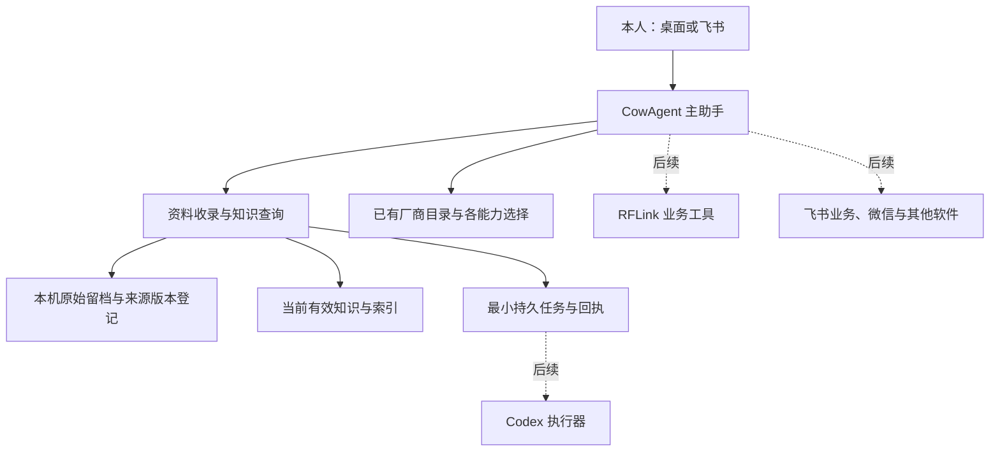

# 个人助手改造方案

2026-11-11 增量：知识收录修复执行安排见第 10 节；真实模型与账号验收按用户最新授权在本次调试启动中执行，取代此前集中留给用户的安排。

日期：2026-11-10（Asia/Shanghai）。状态：可执行，按技术前置和任务依赖推进。方案编写时源码基线为 `a8658548`，方案提交为 `990f9ba1`；实际实施、安装与验证结果见[首期交付记录](../logs/2026-11-10-个人助手首期交付.md)，真实账号认证由用户集中处理。保留现有文件名以维持引用。

本文件保留整体路线，首期行为与数据契约集中在[唯一规格正文](../../../.scratch/personal-assistant-foundation/spec.md)。此前方案中的推荐若与规格冲突，先依据用户最新决定修订规格；历史调研作为事实依据，不作为实施指令。

## 1. 第一目标与已确认事项

首期 A/B 阶段交付：**本机可安装、有原桌面界面的个人助手，能从本人飞书接收文本 PDF、DOCX、XLSX，按用途整理知识，并给出能回查原文的回答。**

| 事项 | 用户确认／当前边界 |
| --- | --- |
| 使用与部署 | 本人使用、本机在线期间可用；本机入口与飞书私聊共用知识。复用官方 Windows 界面与模型设置。 |
| 首批资料 | 文本 PDF、Word、Excel 同批；按 PDF/DOCX/XLSX 验收，保留 MD/TXT。 |
| 资料发送 | 原件留本机，必要内容可交给指定云端模型，遵循 [ADR-0001](../../adr/0001-local-sources-cloud-context.md)。 |
| 原始留档 | 最新明确选择：会话、附件、处理记录完整保留，首期不自动清理；替代此前七天清理的建议。 |
| 新旧安装 | 定制版独立目录、从空目录开始；当前没有官方历史数据迁移需求。 |
| 知识判断 | 沿用现有主 Agent 与知识技能自主整理，分享资料后主动提炼，不逐份询问是否收录；具体行为见规格 PA-07。D-03 已解决。 |
| 模型配置 | 各能力独立可替换 Provider、密钥、模型。会话 MuzeAI/gpt-6.1-sol；绘图 Aikun/flare、sunburst；完整初值只维护在[规格第 7 节](../../../.scratch/personal-assistant-foundation/spec.md#7-provider-与配置切换)。 |
| 主路线 | 沿用 CowAgent，增强现有知识；GBrain、LangGraph 以后按实际增量评估。 |
| 后续路线 | Codex 编程、RFLink 业务接口、微信、更多飞书业务、Office/PDF 输出与建模分期讨论。 |

[领域术语](../../../CONTEXT.md)区分资料原件、原始留档、长期知识和专业任务。首期完整留档、长期收录和模型上下文是三项不同职责。

## 2. 现有代码能复用什么

| 源码事实／测试基线 | 方案结论 |
| --- | --- |
| Electron/React 桌面、Web、飞书、主循环及 MCP 已有。 | 从本仓库原桌面端启动，不新增主助手框架或配置后台。 |
| 桌面 ModelsTab 已有自定义厂商、地址/密钥、模型目录与能力选择。 | 两个中转首先通过界面配置；逐项验证兼容协议，不能把“新建 Provider”写成新开发功能。 |
| Chat、image-generation、自定义语音、Embedding 已有独立 Provider 入口。 | 复用现有字段与实现，补配置切换一致性；供应商未知时不猜测替代端点。 |
| 知识功能启用并初始化后，系统提示明确要求分享资料或形成知识时主动写入；knowledge-wiki 已提供整理流程。 | 沿用模型自主处理，验证提示/技能实际加载；改造重点是可靠收录工具、用途传递和各写入入口一致。 |
| 知识导入当前只支持 MD/TXT；阅读工具已抽取 PDF/DOCX/XLSX。 | 共享解析，补完整解析稿和出处映射。阅读展示的分页/截断结果不能充当入库全文。 |
| 飞书附件关联是默认五分钟的内存缓存，消息去重亦在内存；启动前积压有过滤。 | 增加持久 receipt/task，再异步处理；恢复已接收任务与处理未登记积压分开。 |
| 知识文件保存成功与索引成功未形成统一回执。 | 建立 pending_index 与有效发布记录，索引失败不能返回可检索成功。 |
| Embedding 留空会走旧自动初始化；文件哈希及维度检查不足以识别同维换模型。 | 首期关键词模式需显式关闭向量请求；世代隔离放在启用向量前。 |
| 既有知识发布原子写、设置写锁、语音路由和备份有测试。 | 将其作为回归入口；新增来源版本、持久任务、身份和恢复语义另补验证。 |

本机环境的上轮观察是：没有本项目独立环境和运行配置，PATH 的 Python 指向 3.14，已有 uv/codex。实施前 P-01 重新确认，不能将历史观察当成已通过启动验证。

## 3. 建议的改造结构

职责与权威来源：

- 资料原件、用途、版本、发布指针和任务记录是权威数据；知识投影、解析稿和索引可重建，规则见规格 PA-05、PA-08、PA-11。
- 主 Agent 决定用途，程序执行并回执。各入口使用相同来源与发布规则，临时原始归档不自动进入长期检索，规则见 PA-07、PA-09、PA-13。
- 最小持久任务先覆盖收录与结果通知，后续执行器再扩展；不把首期变成完整工作流平台。
- Windows 交付复用现有后端打包和 Electron/NSIS；独立身份、数据与更新渠道在首期验证，不建设旧官方数据迁移功能。
- 模型设置沿用原 UI；新增界面只展示收录状态、来源、版本、可执行重试/取消等必要动作。说明放在问号悬停中，隐藏/禁用/可执行状态按实际权限和任务状态决定。

## 4. 按可用成果推进

| 阶段 | 可用成果 | 本期规格／边界 |
| --- | --- | --- |
| A：本机与飞书基线 | 本仓库桌面端可启动，原模型页配置会话中转，本人私聊可交互，附件持久接收。 | PA-01、PA-02、PA-03、PA-04；按第 5 节探针与 T-01、T-02 推进。 |
| B1：三类资料闭环 | PDF/DOCX/XLSX 都能按用途处理、返回真实收录状态，回答能定位原文。 | PA-05、PA-06、PA-07、PA-08、PA-13；三格式同批验收，工程上可以逐个贯通。 |
| B2：持续使用与 Windows 交付 | 版本、更正撤回、重启恢复、备份及安装版三格式闭环可验证。 | PA-09、PA-10、PA-11；首期验收不能只看源码运行。 |
| C：任务与编程 | 飞书委派 Codex，交付代码与验证结果，可查询/取消并对账。 | 后续单独规格；不在本期冻结 Codex 的执行权限或恢复语义。 |
| D：RFLink 专业闭环 | 只读工程与器件 → 副本候选 → 校验预算 → 预览保存与材料。 | 后续另仓业务契约；不能把现有 ping 当成设计接口。 |
| E：按使用频率扩展 | 微信、飞书业务、Office/PDF 输出及箱体/丝印。 | 各能力按真实任务补规格、接口与交付验收。 |

飞书业务接入按任务逐项补齐；首期机器人入口不等于已覆盖云文档、表格和日历。Embedding 世代切换为 P-05/T-08 条件分支，不阻塞关键词资料问答；独立配置能力仍保留。

## 5. 第一批从哪里开始

### 隔离探针与技术前置

以下执行安排形成于方案提交 `990f9ba1`；实施进展、实际验证与未运行项见[首期交付记录](../logs/2026-11-10-个人助手首期交付.md)。使用独立测试目录与替身优先；真正服务探针使用用户选定的连接和测试资料，实施时只做必要请求。

| ID | 探针／产出 | 通过标准 | 只阻塞哪些任务 |
| --- | --- | --- | --- |
| P-01 | 本机环境、原桌面启动、会话中转和工具调用；记录支持的协议与依赖版本。 | 本仓库桌面用独立环境启动；真实短对话与一次无外部写入工具调用成功，协议/模型准确可查。 | T-01、T-02 的真实联调和之后端到端；不阻塞离线文档、纯解析或替身测试。 |
| P-02 | 独立数据根、应用标识、空目录初始化、官方更新源与备份边界清单。 | 不碰官方目录，源码与安装模式写入位置可解释；关闭或替换定制包的官方自动更新路径。 | T-07 安装与升级；T-02 可先用隔离临时根实现。 |
| P-03 | 代表 PDF/DOCX/XLSX 的解析、定位、限额与索引回执探针。 | 每类有预设问题与原文位置；超限/损坏/公式缓存缺失均可辨识，能验证索引真实成功。 | T-03、T-04、T-06 的对应解析与发布部分。 |
| P-04 | 各启用能力的独立连接与配置刷新；检查现有两入口 API 的保存/缓存差异。 | 用不同替身地址/密钥标记可确认请求归属，换配置后新旧任务符合 PA-03。 | T-01 完成条件；未启用绘图/ASR/TTS 无真实端点依赖。 |
| P-05（条件） | 选定 Embedding 后检查指纹、同维换模型、缓存与失败恢复。 | 不兼容世代不混搜；失败保留现有权威数据和可用索引／关键词降级。 | 仅 T-08 及正式启用向量检索。 |

### 任务与规则、验证映射

本表是本轮唯一执行细节。实际拆票时每票独立成文并链接相应规格；下表为计划编号，满足各自依赖的任务可按本地规则分诊。文件为预期影响面，同范围必要辅助文件纳入任务后复核。

| 任务 | 目标与规格 | 预期模块／文件 | 依赖／阻塞 | 验证与完成标准 |
| --- | --- | --- | --- | --- |
| T-01 配置与运行基线 | 复用 GUI 完成 PA-01、PA-03、PA-13；显式关键词模式，修复实际发现的配置切换缺口。 | desktop 原启动/设置页、config.py、models/custom_provider.py、channel/web/api/models.py 与 config.py、bridge、Embedding 工厂。 | P-01、P-04；纯替身测试可先行。排队/恢复配置归属的集成验收待 T-02 接收记录存在后完成。 | V-01、V-09、V-10 的停用部分；两个中转能从原界面配置，新任务用新配置；已排队、重试、重启任务不静默变更接收时绑定；不意外调用 Embedding。 |
| T-02 可信身份与持久接收 | PA-02、PA-04 与 PA-10 的接收半程；先记录再回执，重复重试复用。 | channel/feishu、channel/file_cache.py、common/runtime_identity.py；新增收录接收/最小任务模块及状态路径帮助函数。 | P-01 联调；入口身份字段核查，独立测试根。 | V-02/V-03；陌生身份不能触发下载与模型，重启仍可查 receipt，磁盘失败不报已接收。 |
| T-03 共享解析与来源版本 | PA-05、PA-06，建立原件、解析、出处和版本关联。 | agent/knowledge、agent/tools/read/read.py、common/office_text.py、common/state_dir.py；来源登记与解析模块，现有阅读行为保留。 | T-02、P-03。 | V-04；三格式分别可回查位置，原件完整保留，公式/限额/损坏处理准确。 |
| T-04 用途与发布闭环 | PA-07、PA-08、PA-09、PA-13 及托管写入一致性。 | agent/prompt/builder.py、skills/knowledge-wiki、知识服务/收录工具、write/edit、摘要/Deep Dream、memory_search/get/缓存与发布投影。 | T-03；P-03 索引可用判断。D-03 已解决，沿用自主整理。 | V-05、V-06、V-07、V-13；主动整理与必要澄清符合 PA-07，成功/暂存/待索引可区分，各入口过滤失效引用；撤回/更正先提交时迟到候选及重启不能恢复旧结论；临时内容仅原始留档。 |
| T-05 恢复、取消与通知 | 完成 PA-04、PA-10，复用当前渠道发送，不重复业务。 | 最小任务模块、飞书进出消息、启动对账与通知登记。 | T-02/T-04 的发布提交约定。 | V-08；阶段中断可恢复/核对，取消竞态和通知失败均保留正确结果。 |
| T-06 原界面与兼容回归 | PA-01、PA-08、PA-09、PA-11，补状态、出处、版本与有效动作；旧未托管资料继续工作。 | desktop 原知识/任务页、Web 知识 API、收录工具与知识 CLI；仅补必要视图和字段。 | T-01/T-03/T-04/T-05。 | V-04～V-09/V-11/V-13 的界面及旧 API 用例；未配置/等待输入/失败态动作清楚，原配置入口可复用。 |
| T-07 备份与 Windows 包 | PA-01、PA-11，独立数据根、完整备份和安装交付。 | cli/commands/backup.py、desktop 主进程/配置、desktop/build 依赖/spec、package 构建与自用更新配置。 | P-02、T-06；打包试编可前置。 | V-11、V-12；一致备份恢复会话、附件、处理轨迹和权威关联；空目录安装版三格式闭环；降版前保留最新全量快照并标记兼容恢复点，回升后较新留档可恢复。 |
| T-08 向量启用（条件） | PA-12，明确指纹和世代切换。 | agent/memory/embedding、manager/storage/vector_backend、设置入口与缓存。 | 用户选定 Provider/发送范围、P-05；A/B 关键词闭环不依赖它。 | V-10 全部：同维换模型不混搜，失败不清空权威数据，切换后引用连续。 |

现有回归入口，按改动选择：

- 知识写入/旧 API：[test_knowledge_service.py](../../../tests/test_knowledge_service.py)、[test_knowledge_web.py](../../../tests/test_knowledge_web.py)、[test_knowledge_publication_failure.py](../../../tests/test_knowledge_publication_failure.py)。
- 配置与能力：[test_models_handler.py](../../../tests/test_models_handler.py)、[test_models_config_write_lock.py](../../../tests/test_models_config_write_lock.py)、[test_custom_provider_handlers.py](../../../tests/test_custom_provider_handlers.py)、[test_custom_voice.py](../../../tests/test_custom_voice.py)、[test_image_generation_custom_provider.py](../../../tests/test_image_generation_custom_provider.py)。
- 文件入口：[test_feishu_post_attachments.py](../../../tests/test_feishu_post_attachments.py)、[test_file_cache.py](../../../tests/test_file_cache.py)；新增持久接收测试不能由内存缓存测试替代。
- 备份：[test_cli_backup.py](../../../tests/test_cli_backup.py)；需补新增数据、SQLite 一致快照与关联检查。

本轮不运行产品测试。实施时按任务验证；提交/PR 若触发仓库 CI，则遵循[现有后端 pytest 与变更 Python F 类检查](../../../.github/workflows/test.yml)。普通文档改动不强制全量跑测试。

## 6. 决策清单

已确认项目全部维护在第 1 节，保留策略和独立新目录不再询问。仍影响任务的条目如下：

| ID | 状态／性质 | 默认提案或下一步 | 受影响任务 |
| --- | --- | --- | --- |
| D-03 | 已解决，不再待确认 | 规格第 6 节沿用主 Agent 与知识技能自主整理，遵守临时用途；只在缺少必要信息时具体澄清。用户已要求自主判断，本轮纠正重复审批。 | T-04 不再有该决策阻塞。 |
| P-01～P-04 | 技术前置，未验证 | 先隔离验证现有界面/接口，再确定最小补丁；不把技术未知转成重复问用户。 | 第 5 节逐项标明。 |
| 条件能力选择 | 部署时再选 | Embedding、ASR、TTS 供应商、绘图默认/备用；未启用时不额外请求其他供应商。 | 该能力端点联调与 T-08，不阻塞首期文本问答。 |
| 后续专业范围 | 后续阶段再讨论 | Codex 项目/权限/交付；RFLink 当前工程状态、身份、副本与预算/导出快照。 | C/D；本期不细化。 |

应用名、独立目录具体路径、私有函数、锁和模块内部组织属于实现安排。保持规格约束即可，不为这些选择额外增加人工批准。

## 7. Matt 流程如何衔接

本轮在 `grill-with-docs` 讨论基础上应用仓库 `major-change-docs-gate`，形成首期[实施规格](../../../.scratch/personal-assistant-foundation/spec.md)，并以本计划承载执行映射。用户已要求提交并交另一会话执行；既有自主整理要求已消除 D-03 的重复待确认状态。

执行会话先做 P-01～P-04 的适用探针，按第 5 节依赖推进 T-01～T-07。技术问题由源码、替身与真实运行验证解决，只有新出现的实质业务取舍才回到用户讨论；实施偏离既有契约时更新受影响的规格与 Gate，不新增全项目审批轮次。

正式拆票遵循[本地任务规则](../../agents/issue-tracker.md)，每票一个 `.scratch/personal-assistant-foundation/issues/NN-<slug>.md`，写明规格 ID、依赖与本表任务定位。当前尚未生成实施工单或开始产品实现；执行会话直接读取本规格与计划。

## 8. 源码与调研依据

| 主题 | 证据定位 |
| --- | --- |
| 模型自主知识写入 | [系统提示](../../../agent/prompt/builder.py#L654)、[knowledge-wiki](../../../skills/knowledge-wiki/SKILL.md)。 |
| 文件接收与积压过滤 | [飞书通道](../../../channel/feishu/feishu_channel.py#L733)、[内存缓存](../../../channel/file_cache.py#L13)。 |
| 知识保存与索引 | [知识服务](../../../agent/knowledge/service.py#L132)、[文件阅读/解析](../../../agent/tools/read/read.py#L550)。 |
| 独立模型能力 | [聊天](../../../models/chatgpt/chat_gpt_bot.py#L42)、[图片组](../../../config.py#L862)、[语音](../../../voice/custom/custom_voice.py#L36)、[Embedding 工厂](../../../agent/memory/embedding/factory.py#L24)。 |
| GUI 与配置保存 | [桌面厂商表单](../../../desktop/src/renderer/src/pages/settings/ModelsTab.tsx#L617)、[能力卡](../../../desktop/src/renderer/src/pages/settings/CapabilityCard.tsx#L47)、[通用刷新条件](../../../channel/web/api/config.py#L272)。 |
| 桌面与安装 | [后端启动](../../../desktop/src/main/python-manager.ts#L718)、[Windows 包](../../../desktop/package.json#L93)、[PyInstaller](../../../.github/workflows/release.yml#L95)。 |
| 备份与索引 | [备份入口](../../../cli/commands/backup.py#L119)、[文件哈希同步](../../../agent/memory/manager.py#L444)、[向量检索过滤](../../../agent/memory/storage.py#L877)。 |
| 路线与后续 | [起步路线](../research/2026-11-10-起步技术路线建议.md)、[Codex 分工](../research/2026-11-10-CowAgent与Codex的分工.md)、[RFLink 评估](../research/2026-11-10-RFLinkManager助手接口评估.md)、[飞书/微信](../research/2026-11-10-飞书与微信接入边界.md)。 |

## 9. 专项审查结论与剩余问题

### 发现与修订

以下是原方案的文档缺口及本轮处置，严重度描述潜在实现后果，不表示当前运行实例发生故障。

| ID／严重度 | 原方案缺口与影响 | 文档处置／剩余入口 |
| --- | --- | --- |
| F-01 / P1 | “已保存”和“可检索”未区分；索引失败仍可能被当成功。 | PA-04、PA-08、V-06 和 T-04 固定发布与索引回执；真实实现待验证。 |
| F-02 / P1 | 完整留档、临时使用与长期记忆混在一起，可能造成误收录或意外清理。 | 采用用户最新完整保留选择；PA-07、PA-13 区分原始归档与长期用途。D-03 已纠正为沿用自主整理，无需逐份确认。 |
| F-03 / P1 | 同名/同哈希资料与“新版替代”未分清；更正撤回和旧引用缺乏一致语义。 | PA-05、PA-09、V-07、V-13、T-03、T-04；明确身份、内容及有效状态修订、失效过滤和历史回查。专项复核补充发布提交屏障，防止迟到候选重新发布失效结论。 |
| F-04 / P1 | 本人范围只有描述，未定义可信身份、消息去重与已接收恢复点。 | PA-02、PA-04、PA-10、V-02/V-03/V-08、T-02、T-05；接收前校验和持久登记，通知独立。 |
| F-05 / P1 | 多 Provider “能配置”被等同于切换可兑现；Embedding 自动初始化与同维换模型有缺口。 | PA-03、PA-12，T-01 显式关闭向量并做缓存生效；T-08 单独处理向量世代。复核补齐排队任务在接收时绑定配置、重启/重试不静默换连接。 |
| F-06 / P2 | 桌面开发能启动未等于安装可用，数据路径、更新与备份恢复未映射。 | PA-01、PA-11，P-02、T-07，V-11、V-12；独立新目录，无历史迁移功能。复核补全会话/附件关联/处理记录备份，以及降版前最新全量快照和回升恢复。 |
| F-07 / P2 | 阶段表缺少规则到文件、依赖与验收的闭环。 | 新增 PA/V/T 稳定 ID 与第 5 节唯一执行表；后续拆票只引用，不重复定义业务规则。 |

### Gate 与证据状态

| 检查 | 本轮结论 | 证据与范围 | 未决／受影响任务 |
| --- | --- | --- | --- |
| Gate 0/1 | PASS | 当前规则、源码/已有测试与用户决策已核对；按行为影响定为重大变更。 | 无范围分级未决。 |
| Gate 2/3/4 | PASS（文档） | 首期契约已集中；D-01/D-02 采用用户选择，D-03 沿用用户要求和现有模型自主整理能力，移除重复确认。 | 无首期业务默认待决策；技术前置见 P-01～P-04。 |
| Gate 5 | PASS（文档） | 三个专项复核发现的候选失效屏障、排队配置归属、完整备份验收已修订并复核关闭；本轮再核对自主整理源码与用户要求，关闭 D-03。 | 产品实现及实际验证尚待执行。 |
| Gate 6/7 | PASS（执行安排覆盖） | PA→T→V、预期文件、依赖及通过标准已检查；现有任务前置和条件分支可定位。 | 尚未拆成可领取工单，不表示产品任务已完成。 |
| Gate 8 | PASS（文档一致性） | PA→T→V 映射完整，T-04 已去除 D-03 决策前置；其余任务依赖与条件分支不变。 | 技术探针仍为对应任务前置，未运行；按依赖推进，不整体暂停。 |
| Gate 9 | PASS（文档证据）；产品验证未运行 | UTF-8、围栏、本地链接/锚点、13 条规则与 13 个验收 ID、8 项任务的静态完整性检查通过；三个专项复核已记录，方案文档纳入本次提交。 | 实际端点、Agent、故障恢复和安装验证均未运行；当前只交付文档。 |

评审者：Codex 主代理与知识、Provider/桌面、消息/任务专项子代理。日期：2026-11-10。以上为代理文档检查，未接入自动门禁；PASS 不等于产品测试通过。

## 10. 知识整理修复（2026-11-11）

唯一契约正文为规格第 5.5 节。用户通过 grilling 确认主题拆页、跨来源合并及更新已有页、整页与派生依赖失效、现有单份资料复用原件重整、接通视觉及部分完成可发布，并要求本会话审核提交、不推送；后续明确授权使用调试启动执行真实账号和模型验收。

| 任务 | 影响面 | 验证与完成标准 |
| --- | --- | --- |
| K-01 主题页受控发布 | 来源服务、新增知识页服务、来源状态与读取守卫 | 一源多页、多源一页、页更新冲突、块级出处、相关关系与派生依赖、整页及下游暂停、迟到提交拒绝、索引失败与重启幂等；兼容旧来源与路径恢复。 |
| K-02 Agent 实际整理 | knowledge_ingest/source_action、read、knowledge-wiki、prompt、worker/intake | 替身经过真实 Agent 回路读取技能、读取资料、提交模型整理正文；长期/临时/必要澄清、跨来源和更新已有页；缺整理成品不假成功。 |
| K-03 视觉覆盖 | PDF 解析及页面渲染、已有 vision 的适配、依赖与打包清单 | 扫描/混合/矢量页面、页号与类型、配置不可用与失败覆盖记录、部分可靠知识发布；不把文字解析当成完整理解，不意外 Embedding 请求。 |
| K-04 检索与界面 | memory/knowledge 服务、个人资料 API、React 知识及任务页 | 整理正文可检索，标题分类、原件、可读出处、知识图谱、当前有效且索引核验通过才标可检索；失效过滤贯通目录、直读、缓存和后续上下文。 |
| K-05 恢复与交付 | 任务恢复、备份、代表夹具、调试验证、月度日志 | 原件复用重整、旧引用保留、提交前后重启、异路径备份恢复；真实调试启动和当前单份资料端到端；中文审核提交、不推送。 |

实施复核补充：K-01 使用已发布来源头与旧投影退役登记，保证新版候选失败保留旧有效页，旧投影不复活；撤回先提交失效再重建目录。K-02/K-04 覆盖普通问答派生写入及摘要、跨来源次要来源动作和长 PDF 覆盖信息预算。K-03 复用成功视觉解析稿；DOCX/XLSX 嵌图与图表未实现视觉识别时明确列出缺口。实际受影响辅助文件增加 models/config_revision.py、agent/memory/summarizer.py、memory_search/get、cli/commands/backup.py 及相应回归测试，范围仍属于本规格来源、配置与恢复契约。

Gate 0/1：源码已核实新增收录目前是摘要与原文拼接，按持久化、跨来源及恢复影响判重大变更。Gate 5/7/8：本节 K→规格 5.5→上述验证已核对，业务决策已收敛；采用增量表和附加记录兼容旧数据，未知版本仍拒绝写入。产品验证状态在实施完成后补入项目日志；不把文档 PASS 当作运行结果。

K-01～K-05 已完成实施和独立审核。Gate 9：离线／替身定向回归 436 项通过，真实模型重整现有 PDF、关键词问答、原件及出处核验、停机备份、异根恢复和最终调试重启已运行；视觉局部缺口与真实飞书渠道未运行项保留事实边界，详见[知识整理修复验证记录](../logs/2026-11-11-知识整理修复.md)。
