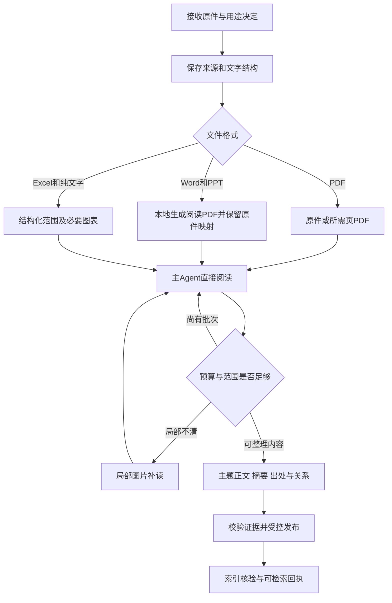

# 文档读取与知识入库优化方案

日期：2026-11-11，Asia/Shanghai。状态：文档审查通过；2026-11-12 已完成 PDF、Word、PPT 的核心链路隔离验收，整体交付未完成，剩余范围见真实链路验收。业务规则唯一正文为[规格 5.8／PA-15](../../../.scratch/personal-assistant-foundation/spec.md#58-文档读取与知识入库优化2026-11-11-方案pa-15)，领取入口为[工单 16](../../../.scratch/personal-assistant-foundation/issues/16-document-reading.md)。本文维护技术前置、任务、验证及交付安排，不替代规格。

执行进展见[真实链路验收](../logs/2026-11-12-文档读取真实验收.md)及[实施与 V-19～26 证据记录](../logs/2026-11-12-文档原生读取实施.md)。当前真实主Agent已完成PDF、Word、PPT及中文扫描PDF的主题入库、摘要、关键词检索与出处回读；技术PDF正文／首次／修复后缓存均23/23。中文12页实际分三批合并为3主题；三种格式11主题已完整备份异根恢复。局部放大及XLSX图片对象选读已接实际read，安装与客户端收口继续；隐藏页后补，脚本安全控制按用户指示暂不处理。真实配置及知识库未改。

2026-11-12 用户后续调整：本轮先不处理自动化脚本安全控制，不再以其证明缺口阻塞转换选型和内容验证；优先核对成熟第三方／Python 方案，并参考现有 PDF 技能。先验证 Word／PPT 排版、图表、隐藏页及定位，原 COM 探针仅保留历史事实，不继续扩展。以下安全探针要求保留为原方案记录，不作为当前阶段的额外前置。

当前推进优先级进一步收敛：先跑通常规可见页、图表和文字的转换及阅读。隐藏页作为后续补充项，不因其尚未覆盖阻塞常规路线开发；仅处理可见页时如实保留范围，不能称已覆盖所有幻灯片。

**目标是让主 Agent 尽量直接阅读完整图文，再整理成有出处的主题知识；把逐页转写从默认必经步骤改为按需补读。** 文件准备由程序完成，理解、主题拆分／合并、正文与每页摘要由主 Agent 完成，发布仍经过现有来源与索引校验。

## 1. 依据与当前缺口

- [PDF 实测记录](../logs/2026-11-11-PDF读取方案对比.md)：同一 6 页、23 点题集，两路均答对；原生 1 次／38.069 秒，当前 7 次／202.204 秒。12 页及 68 页原件可直接读取，长文件需要合适上传超时。该比较验证问答与传输，不代表生产 Agent、主题整理及入库已接通；逐页路线还生成了可复用观察，不能照搬性能倍数承诺。
- [OpenAI 文件输入说明](https://developers.openai.com/api/docs/guides/file-inputs#non-pdf-image-and-chart-limitations)：PDF 同时提供文字和页面图像；DOCX／PPTX 直接输入只提文字，官方建议保留图表时先转 PDF。当前可用的是 MUZE Responses 内嵌 PDF，标准 Files 上传没有通过；接口能力按实际 Provider 修订验证。
- 生产 `read` 默认在文字解析后逐页调用 Vision；`responses_adapter` 尚不接受原生 file 输入，Agent 工具结果字符串化，直接把 file 字典塞进工具返回不会让模型看到文档。
- 入库解析仅接 PDF／DOCX／XLSX／MD／TXT，PPTX 普通读取能提文字但尚未接入受控资料解析。旧 DOC／PPT 的后缀分支不等于能解析二进制格式；Office 图片／图表目前主要登记缺口，缺少阅读副本及可靠位置映射。
- 出处校验要求不可变 `parse_id` 和真实单元，不能用“附件已读”占位绕过。摘要增量规格 5.7 与工单 15 继续有效；源码已可见摘要字段和恢复测试，本轮未验证其最终交付状态，实施前按实际代码与任务清单集成。

本机已发现 Microsoft Word／PowerPoint 16 的可执行程序及 COM 注册；项目 `.venv` 没有 win32com，系统 Python 有。未发现 LibreOffice。这些仅是探针前置，不等于 Office 已授权、可静默转换或排版可靠；不能让应用默认调用任意系统 Python。

## 2. 目标流程

阅读材料和知识成品各存一次必要产物，避免模型先做全量转写又重复总结。普通问答按问题选范围，入库按指定资料范围处理；没有完整覆盖时保留续读和缺口。格式及附加层边界按 RD-01／02，原件保留和用途按原规格执行。

## 3. 技术前置与选择

| 前置 | 探针内容与通过条件 | 未通过时的安排 |
| --- | --- | --- |
| P-01 原生媒体进入实际主 Agent | 使用当前 Provider／模型和任务配置，验证 PDF＋工具调用＋流式返回＋下一轮工具结果；截获请求确认真实媒体块、归属与阅读回执。已有单次问答探针复用，不重复宣称已覆盖 Agent 集成。 | 将原生集成保持未就绪，已有文字／视觉继续工作；不因一次网络错误永久关闭能力。 |
| P-02 Office 转换与结构映射 | 在隔离副本上验证 Word／PowerPoint 本地导出、字体／公式／图表、隐藏页／备注和原件锚点；转换器进程可独立回收且不改用户设置。 | PDF 任务独立继续。Office 先提供可靠结构文字和可定位图片／缺口；不以不可靠页码冒充完成。 |
| P-03 证据与恢复 | 先在隔离的最小原型／夹具中，用纯图片页及 Office 图形验证阅读凭据→观察→不可变解析单元→主题来源；原件／副本篡改、未送达、越界引用均失败。此项验证契约可落地，不要求先完成 O-04 全部生产代码或写真实知识库。 | 原生可用于一般问答，但相关图文知识发布不得绕过旧守卫；修复后再进入入库验收。 |

本轮选择以本地 Office 转换器作为当前 Windows 环境的首个探针候选；仅在项目运行环境和打包环境中补齐并验证最小依赖后启用。转换器采用可替换边界，不能把 Office 安装存在设为应用其他能力的启动前提。LibreOffice 可作为后续可选适配器，不为本次方案默认安装或同时实现两套转换器；若 Office 探针不能满足安全和版式契约，另做该适配器的有界探针再调整对应任务，PDF 及文本路线不被阻塞。

## 4. 实施顺序与影响面

| 任务 | 目标／规格 | 预期影响模块 | 依赖、验证及完成标准 |
| --- | --- | --- | --- |
| O-01 能力及转换探针 | 建立真实基线，RD-01～04，V-19／20／21。 | `models/openai/`、`models/custom_provider.py`、`agent/tools/vision/` 的只读核查；隔离探针和代表夹具、依赖清单。 | 先完成 P-01～03 所需最小实验。PDF 和 Office 分别出具通过／不通过证据、依赖、未覆盖项；业务未知不伪装成配置开关。 |
| O-02 阅读材料与格式准备 | 不触发模型的文字／结构提取、阅读副本、映射与缓存，RD-01／02／07，V-19／20／25。 | `agent/knowledge/parser.py`、`common/office_text.py`、`agent/knowledge/personal_assistant.py`；按需新增文档材料／本地转换适配模块、PPTX 解析、XLSX 嵌图与对象定位及依赖检测。 | 接 O-01 各格式结果。PDF 先去掉非必要预渲染；DOCX／PPTX 增加有效转换与映射；XLSX 嵌图提取及锚点回读、公式／缓存语义通过，图表未渲染保持真实缺口。转换时原件哈希不变，缺环境／字体／超时有真实结果。PDF 和 Office 独立子项可并行。 |
| O-03 主 Agent 媒体交付与分批 | 让文件真正进入主模型，控制范围、上下文、时限和历史复用，RD-03／04，V-21／23。 | `agent/tools/read/read.py`、`agent/tools/base_tool.py`、`agent/protocol/agent_stream.py`、`models/openai/responses_adapter.py`、`models/openai_compatible_bot.py`、`models/openai/openai_http_client.py`、`models/config_revision.py`。 | 依赖 P-01 及 O-02 稳定材料描述。优先只实现已验证的 Responses 内嵌 PDF，不同时扩张 Files／URL。作用域和真实媒体块、visual=false、分页、上下文压缩、不支持协议及长批次均通过；普通读取也复用该能力，仍遵守原路径权限。 |
| O-04 阅读凭据与图文出处 | 原生观察进入既有可追溯来源，RD-05／07，V-22／24／25。 | `agent/knowledge/personal_assistant.py`、`agent/knowledge/wiki.py`、`agent/tools/knowledge_ingest.py`、`common/personal_tasks.py`；阅读子记录与必要附加表。 | 可基于 O-02 描述和伪造请求夹具与 O-03 并行。两种输入来源解析为程序核验的四元出处；拒绝占位、越界和失效。实现 reading_submission_id 与别名载荷比较，同键重放／冲突、输入乱序、多 reading 重名及观察保存后中断均不串改出处；受信接续不改原产生身份。先打通 P-03 再接发布。 |
| O-05 主 Agent 直接整理与主题合并 | 省去全量逐页转述，保留每页摘要、分类、关系和来源，RD-06，V-23／24／26。 | `skills/knowledge-wiki/SKILL.md`、`agent/prompt/builder.py`、`common/personal_worker.py`、`agent/tools/knowledge_ingest.py`、`agent/knowledge/visual.py` 及真实加载的技能。 | 依赖 O-03／04。实际 Agent 回路依据持久化目标范围提交正文／摘要／证据；阅读和发布批次不能改小整体目标；大文档按主题合并，补读仅处理缺口，跨资料与旧页更新保留身份和分类。与工单 15 的独立拓扑任务分别完成，不重复实现摘要或合成跨任务事务。 |
| O-06 恢复、回执与运行集成 | 全部检查点可恢复，覆盖范围、部分成果与整任务结果一致，RD-07／08，V-23～26。 | `common/personal_worker.py`、`common/personal_tasks.py`、`agent/tools/knowledge_ingest.py` 的 resume_publication、`channel/web/api/personal.py`、`channel/web/api/knowledge.py`、桌面资料／任务展示、Web 对应页、`cli/commands/backup.py`、启动依赖检查及 `desktop/build/requirements-desktop.txt`。 | 依赖 O-02～05。替换“任一发布批次成功就 complete／worker 返回”的行为：按已登记批次提交身份对账后继续剩余目标，仅整体满足才 complete；预算耗尽失败并保留 result_refs。旧 attempt 回调拒绝，持久产物经受信接续复用，跨任务建立新 reading 身份。部分发布后取消只停止剩余工作，重试不重复已完成批次。安装、异根恢复与已有界面通过。 |
| O-07 质量、成本及交付验收 | 证明真实入库有用，RD-08，V-19～26。 | 本节第 5 节对应测试、真实资料／离线夹具、脱敏记录和运行证据；必要文档与日志。 | 按格式依赖 O-02～06 的共用部分及该格式实现、工单 15 适用契约集成回归；逐格式通过后启用。PDF 通过不等待 Office，Word／PPT 未就绪维持其旧／降级能力；全格式完成再收口本票。记录知识质量、首次／复用成本及未覆盖项。 |

建议先把 **PDF 原生读取→有出处的主题知识**贯通，再接 Word／PPT 转换；后者无需等待 PDF 所有界面收尾，但依赖相同材料与证据契约。O-02 和 O-03／04 可在契约稳定后并行，O-05 联合验证，O-06／07 收口。上表记录预期影响面，同范围必要辅助模块可以补入，不为私有函数命名或拆文件方式冻结实现。

## 5. 验证安排

**格式与主模型：** 复用 `tests/test_personal_read_ingest.py`、`test_personal_read_pages.py`、`test_personal_visual.py`、`test_pptx_container_text.py`、`test_spreadsheet_uncached_formulas.py` 与 `test_spreadsheet_array_formula_text.py`，增加 Word／PPT 转换和阅读材料测试。生成含中文、图内独有信息、矢量流程图、跨页表格、公式、备注及隐藏页的 DOCX／PPTX 夹具；确保只提文字时答不出的题通过图文链路答出。XLSX 夹具包含有锚点图片、图表、缺失／过期公式缓存，验证图片内容和工作表／对象定位、图表未渲染的缺口以及不重算／不刷新外链，不把缓存画面当作已验证计算。验证无 Office／无依赖、缺字体、锁定／损坏文件、转换超时和旧格式，不执行用户宏或外链。必要依赖只加入本次实际使用的运行与打包环境。

**协议与证据：** 扩展 OpenAI 协议／Responses 兼容测试、实际 Agent 循环和 `test_personal_wiki_agent.py`。检查用户／工具消息的角色与 call_id 对应，媒体没有被 JSON 化或截断，后续轮和压缩后不隐式重传。用脱敏请求替身验证真实文件内容块和媒体哈希，不用仅匹配提示词字符串代替。为 `reading_id/evidence_key` 及 `reading_evidence` 增加有效／无效形状、跨任务、旧 attempt、越界、未送达、响应未知、伪造状态和篡改原件／副本测试；旧四元出处原样通过。模型观察必须以模型产物显示。

**知识与并发：** 复用 wiki 发布、来源派生、摘要恢复、catalog/API、`test_personal_worker.py`、`test_personal_resubmit.py` 与 `test_personal_reorganize_api.py`。验证主题拆分／合并和每页摘要、手动分类、同名资料、跨来源、页版本冲突、来源撤回／改临时、上游更新使下游暂停。部分主题已发布但整体仍有批次时中断，重试必须复用成功部分和未提交候选；不能把整体失败解释为清空成功知识，也不能为凑“完整成功”忽略缺口。

**恢复与备份：** 在材料准备后、模型返回前／后、观察保存后、候选保存后、发布提交后但任务回执前分别中断。重点覆盖“首批已提交→回执前退出→重启对账→取消或重试剩余批次”，断言整任务不假成功、成功批次不重复、取消不撤销已发布部分。新 attempt 接续已保存产物应通过，旧 attempt 未落盘回调仍拒绝；换配置重新处理及跨任务复用分别建立可信新身份。增加同键异载荷、并发／乱序重放与观察已存但候选未存的恢复。验证原配置不可用、限流和 TLS 失败分类；只在已发请求但结果未保存的明确窗口可能再次模型调用。完整备份含材料和阅读记录，恢复到新空数据根后回读所有引用；损坏副本与丢失材料不能静默接受，旧发布仍按原状态。对应 V-22～25，旧根和较新现场保留。

**真实入库质量：** 使用当前配置和用户已授权的 PDF 目录，保留 23 点问答作为阅读回归；再从实际发布的主题知识中提出同类问题，沿关键词索引检索、读知识及原件出处，核对正文和每页摘要。Word／PPT 首先使用离线生成且已目视核验的样本，后续用户指定代表资料再补样本，不把 PDF 实测当成 Office 实测。记录图中关系、表格数值／单位、公式、主题组织、出处完整和缺口，不以知识页数量代替质量。

**性能与界面：** 对同一任务目标分别记录首次处理和缓存命中时的准备／上传／模型／整理／发布耗时、请求数、输入／输出 tokens；注明额外观察缓存等产物范围，费用仅在有当前服务商账单时称实付。支持原生且未要求局部补读的代表 PDF，不再固定每页一次识别，应能在同一请求中处理多页；没有新需求、版本或缺口时，复用不得再次发起文档阅读调用。耗时改善报告实测，不设不具依据的统一倍数。检查桌面／Web、窄窗口、键盘提示、原件与阅读副本定位和待补读状态。

按实际改动运行相关 Python 测试、变更文件 Ruff F、相关 Node／TypeScript／renderer 构建及安装依赖检查；不为文档方案提前宣称这些已通过，也不为了凑数量重复全库测试。

## 6. 数据升级、回退与真实库操作

阅读子记录和新解析版本作为兼容增量保存；旧任务／候选继续原路径，原 parser/ordinal 不变。启用新媒体证据后的数据根只由理解该契约的后端操作，降版按规格第 8 节使用备份与兼容恢复点。协议开关退回旧读取仅影响新任务或显式重处理，不能让进行中的已固定配置任务自动改走新协议或重算旧证据。

开发和验收先用隔离根及复制资料；用户本次要求制定方案，不在本轮改写真实知识库。后续实施验收若需要重整现有资料，执行前核对实际主题／版本与未完成候选，停机完整备份；经已有重新整理入口建立独立受信任务，沿用原件、page_id、expected_version、分类和来源状态。补摘要的工单 15 若先完成，复用其有效结果，不强制重新生成；图文来源或阅读目标变化确需整理时再建立新候选。跨页依赖按现有拓扑分批，原知识只在新发布提交后切换，已失效下游不能用旧版本充当回退。

## 7. 文档检查与剩余前置

影响分级：**重大契约增量的受影响范围**。改变主模型媒体交付、出处来源输入、阅读持久化及默认处理路线，并新增 PPTX 入库；需要 Gate 5／7／8。沿用原权限、用途、发布及索引，不引入独立知识真相源。

| 检查 | 当前结论 | 证据／未完成事项 |
| --- | --- | --- |
| Gate 0～4 | 文档项通过 | 已链接实测、官方文档、代码与既有摘要契约；RD-01～08 定义受影响行为，O-01～07 安排实施。 |
| Gate 5／7／8 | 本次文档项通过 | 格式／转换与证据／恢复两个子代理独立审查；1 项 P1、4 项 P2 已修订并逐项复核关闭，具体见下文。技术前置仍按依赖执行，不等于产品通过。 |
| Gate 9 文档 | 通过 | 4 份关联文档 UTF-8、围栏、64 个本地链接／锚点、8 条 RD／8 项新增 V／7 个 O 任务映射及受影响 tracked 文档 diff --check 已检查通过。 |
| Gate 9 产品 | 核心链路通过，整体未完成 | 2026-11-12 真实媒体、PDF／Word／PPT 转换或阅读、主题发布、缓存复用及异根备份恢复已通过；XLSX 图内长期证据、Office 默认部署及完整安装器／干净机器验收待完成，逐项见真实链路验收。 |

技术未知有明确前置和降级结果，不新增逐份用户批准。P-02 未通过仅阻塞对应 Office 转换任务；PDF 主路线与证据契约可独立推进。现阶段没有需要用户新增实质选择的业务选项，具体依赖、探针预算和模块组织在实施中按证据确定。

本次审查关闭的发现：部分批次发布与整任务终态／恢复的区别（P1，RD-06、O-05／06、V-23／24）；旧 attempt 迟到回调与受信产物接续（P2，RD-07、O-04／06、V-25）；证据别名作用域、同键冲突及中断幂等（P2，RD-05、O-04／06、V-22／24／25）；PDF 与 Office 按格式独立放行（P2，RD-08、O-07、V-26）；XLSX 嵌图与未渲染图表的范围及验收（P2，RD-02、O-02、V-20）。两个专题复核均无遗留 P1／P2；这是制定方案时的文档审查结论，后续产品进展以实施记录为准。
