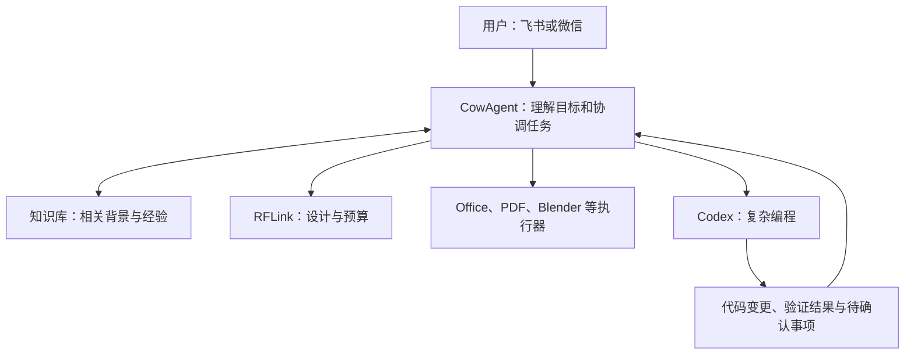

# CowAgent、知识库与 Codex 的分工（讨论补充）

日期：2026-11-10（Asia/Shanghai）。只读研究与讨论记录，未配置集成、安装依赖或执行模型任务。

## 根据用户澄清修正架构依据

用户希望知识库主要为 Agent 提供背景；如果 CowAgent 足够完成任务，就没有主动增加多个 AI 工具的需求。复杂编程目前已在 Codex 中完成。

据此，知识层应先围绕资料解析、检索、来源、更新和上下文质量选型。“是否有多个工具共同读写”只是部署方式之一。一个主助手也可能需要更好的知识治理；多个执行器也可以由主助手统一管理知识。这修正了首轮讨论把共享需求放得过早的切入点。[知识层能力证据](2026-11-10-知识库与GBRAIN评估.md)

## 推荐职责

这是建议的目标架构，调用链尚未实现。用户可以通过统一入口沟通，也可以继续直接使用 Codex 处理需要密集交互的编程任务。专业执行器属于主助手的扩展能力。

应分别验证 CowAgent 的协调能力和它独立完成专业任务的能力；不能由“可扩展”推出所有需求已满足。对于已有成熟编程工具，先复用，再用真实任务比较替代收益。

## 已核实的 Codex 接口

使用 OpenAI Docs 技能实际读取了官方页面，以下为当日文档事实：

| 路径 | 官方能力 | 本项目建议 |
| --- | --- | --- |
| `codex exec` | 非交互运行，JSONL事件、最终输出schema，以及明确会话继续。[O1] | 最小原型可先调用本机CLI。 |
| 官方 SDK | TypeScript和Python接口，可启动、继续与恢复本地Codex会话。[O2] | 要求持续补充条件和程序化管理时评估。 |
| app-server | 持久会话、事件、打断和审批等生命周期控制。[O3][O4] | 深度产品集成时再选。 |

官方SDK文档明确旧 `codex mcp-server` 和独立 `codex-mcp-server` 已移除；新集成不照旧教程启动它。Codex作为MCP客户端连接业务工具是另一回事。CowAgent可以调用自建包装工具，再由包装工具调用CLI/SDK，这属于建议新增的适配。[O2]

本机只读执行 `codex --version` 得到 `codex-cli 0.167.0`，`codex exec --help` 可用。仅核对版本与帮助，没有读取认证文件、验证账户额度或执行编程任务；SDK安装、桌面会话衔接和CowAgent联调均未验证。

Codex的开放运行框架和模型访问是分开的组件。因此在CowAgent中选择相同底层模型，不能直接推断已获得相同的代码任务行为；还应比较上下文组织、工具、测试迭代和任务恢复。这是基于官方组件边界的推断，不是性能横测。[O3]

## CowAgent 当前扩展边界

固定源码仍为 `e5fe38af78c3d9fea7652615c6efdf4f32ba8e0f`。

- 内置 `agent_delegate` 只有 `agent_id`、`task` 入参，面向团队会话中的常驻CowAgent；本地走 `agent_bridge.agent_reply`，远端走peer transport。本轮未见Codex/Claude Code外部CLI委派后端。[工具定义](D:/CodeAndDesign/CowAgent/agent/tools/agent_delegate/agent_delegate.py:264)、[本地执行](D:/CodeAndDesign/CowAgent/agent/tools/agent_delegate/agent_delegate.py:594)、[远端执行](D:/CodeAndDesign/CowAgent/agent/tools/agent_delegate/agent_delegate.py:666)
- `subagent` 构造CowAgent内部临时实例，使用父级工作空间和配置，也不等于启动外部Codex。[子实例构建](D:/CodeAndDesign/CowAgent/agent/subagent/runner.py:100)、[配置继承](D:/CodeAndDesign/CowAgent/agent/subagent/runner.py:131)
- 因此需要增加Codex执行器适配，传入项目路径、目标、相关知识、修改范围和验收条件，管理会话/状态/取消并返回变更与验证结果；“已有委派”不代表这层已完成。

## 知识交接与任务路由建议

以“给RFLink增加一个功能”为例，CowAgent检索相关背景，连同项目路径和验收要求交给Codex；Codex读取真实仓库与项目规则，完成修改和验证，返回差异、结果及未解决问题。个人知识仍可由CowAgent统一维护，Codex按任务获得相关资料，验证后的经验再整理入库，无需先实现整个知识库双向同步。

区分两类工作：使用现有RFLink完成链路设计，主要调用RFLink领域接口；修改RFLink软件增加能力，是编程执行器的典型任务。这是建议的路由规则，尚未实现自动分派。

当前建议是保留CowAgent总入口，并复用用户已经在使用的Codex作为复杂编程执行器。是否让CowAgent独立承担某类编程任务，用同一任务的质量、成功率、耗时和成本比较。GBrain依据知识层增量选择，LangGraph依据流程状态与恢复需求选择；调用Codex本身不要求同时采用它们。

[O1]: https://learn.chatgpt.com/docs/non-interactive-mode
[O2]: https://learn.chatgpt.com/docs/codex-sdk
[O3]: https://developers.openai.com/blog/codex-as-a-platform
[O4]: https://learn.chatgpt.com/docs/app-server
