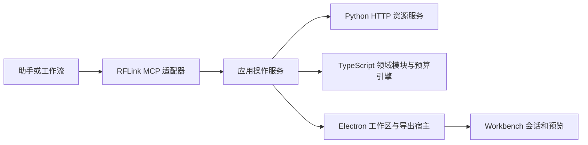

# RFLinkManager 助手接口评估

调研日期：2026-11-10（Asia/Shanghai）。只读静态核查；未启动应用、调用云端接口或修改业务代码。

固定源码：`350298bda5b57d0f6b2c8766776e92095ce94f7c`。本文件里的路径均指 `D:/CodeAndDesign/AI/RFLinkManager`。后续开发前须重新核对当前源码。

## 结论

RFLinkManager 已有适合复用的业务基础，但外部助手尚不能通过现有射频 MCP 直接完成链路设计。建议新增一个薄的应用操作层：对外提供有结构化参数和结果的工具，对内调用现有 TypeScript 领域模块、HTTP 资源服务和 Electron 宿主。工程计算继续使用项目现有引擎。[R1][R2][R3]

接入顺序建议为：只读了解工程 → 在副本生成候选设计 → 校验与预算 → 在应用中预览 → 保存与生成材料。界面自动化负责打开页面、查看图面和缺少接口的操作。以下接口名称均为建议，尚未实现。

## 已有能力与真实缺口

| 核查对象 | 源码事实 | 对助手接入的含义 |
| --- | --- | --- |
| 射频工具 MCP | `tools/rf_design/server.py` 只注册 `ping()`。[R1] | 工具进程可存活不代表可以设计链路。 |
| 平台 MCP | `platform/src/mcp_server.py` 有项目列表、箱体详情、阶段材料完整性、上传文件、文件夹列表和问题查询，共六个操作工具；另有流程、角色、项目概览资源。[R2] | 能解决部分项目查询与交付，未暴露射频画布编辑或预算计算。 |
| 旧入口 | `src/mcp_server.py` 是转发到平台实现的兼容 shim。[R2] | 不应把两处文件误算成两套独立能力。 |
| 资源与审核 HTTP | `platform/src/api/rf_component_library.py` 等包含带 `get_current_user` 依赖的资源、草稿、版本与审核路由。[R3] | 搜索器件、拿确定版本、读取参数优先复用服务 API。 |
| 工作区业务 | `workspaceCore.ts` 有创建工程、导入器件、连接端口、更新实例、校验归档等函数。[R4] | 已有可复用的语义操作；无需让模型逐个拖拽器件重建全部规则。 |
| 预算业务 | `budgetInput.ts` 生成计算输入，`budgetEngine.ts` 导出计算函数与可迭代进度接口。[R5] | 模型负责理解目标、选择候选与解释；数值由统一引擎计算。 |
| 编辑会话 | `workspaceEditSession.ts` 在保存/冻结快照前收束草稿和手势，处理会话身份、模型修订、结果修订和排队保存。[R6] | 外部操作不能只读磁盘旧工程或绕过未完成的界面编辑。 |
| 保存与材料 | Electron 宿主提供保存、校验、注册表、备份恢复；阶段材料有单独编排与写入入口。[R7][R8] | 复用现有保存与生成回执；“材料已生成”和“工程已保存”分别跟踪。 |
| 当前文件结构 | 新建工程使用 V27，锁定器件版本和快照；保存还会检查部分快照完整性。[R4][R7] | 不能让模型直接拼 ZIP/任意改 JSON，绕过迁移、锁定和校验。 |

这里没有实测 HTTP 身份认证、云端可达性、具体工程文件往返或设计质量。上表说明源码接入条件，不代表新助手已经具备这些能力。

## 建议的接入方式

这个边界是架构建议。实际业务跨 TypeScript、Python、Electron 三侧：优先把语义操作服务放在靠近已有 TypeScript 领域模型的一侧，Python 适配器只做协议和资源服务调用。MCP 接口语言可以再选，不应为统一语言而复制预算规则。[R3][R4][R5][R7]

对已打开工程，由应用执行操作并返回新快照/修订，界面与助手共享同一份状态。对离线批处理，可以后续抽取独立的应用服务，但现有 Electron 文件宿主不是天然的纯 Node 无头库，须先梳理依赖。首个原型建议使用已打开的应用和工程副本，避免同时开发两条执行链。[R6][R7]

## 最小工具面（建议）

| 工具组 | 最小操作 | 关键返回 |
| --- | --- | --- |
| `workspace.inspect` | 读取当前工程、活动视图、未保存状态和输入约束 | 工程摘要、修订、待确认输入、能力列表 |
| `resource.search` / `resource.get` | 按类型、频段等筛选器件和线缆，读取确定版本 | 参数、单位、来源、版本和快照标识 |
| `design.plan` | 根据约束生成候选操作清单 | 新增/移除/连接变化及受影响路径 |
| `design.apply` | 对基准修订应用一批经过校验的语义操作 | 新修订、变化清单、阻塞项 |
| `design.validate` | 执行结构和业务校验 | 按严重度区分的诊断 |
| `budget.run` / `budget.get` | 运行指定工况并读取结果 | 运行状态、输入摘要、引擎版本、指标和告警 |
| `workspace.preview` | 定位受影响视图并生成预览 | 预览文件、选中对象、对应修订 |
| `workspace.save` | 保存工程副本或明确目标 | 路径、保存结果、保存修订 |
| `deliverable.export` | 输出阶段报告、BOM、预算和图册 | 文件清单、来源快照、生成结果 |

首版工具参数应覆盖用户意图，不必暴露每一个内部字段。复杂任务通过批量语义命令执行，同时允许助手查询细节。

建议公共参数包括 `operation_id`、`workspace_ref`、`expected_revision`；工具以身份绑定项目授权，不接收可伪造的角色声明。预算和文件生成返回任务引用，允许查询、取消和重启后对账。上述公共契约属于新增设计，不是现有接口事实。

## 需要优先处理的四个工程边界

1. **编辑冲突**：助手应用更改前，检查基准修订及当前用户未提交的草稿。由编辑会话先收束或明确阻塞；不能静默覆盖。[R6]
2. **重试与回执**：创建节点、连线、保存、上传分别有操作标识。请求超时先查询实际结果，避免重试时生成重复器件或重复文件。这是建议的新增能力。
3. **身份与权限**：现有平台 MCP 的工具直接调用懒加载的 `GiteeSync`，函数没有 HTTP 路由中的用户依赖。不能据此默认 MCP 与 HTTP 的授权检查等价；对外扩展前应复用用户身份与项目权限判断。[R2][R3]
4. **工程证据**：器件版本、参数来源、频率/功率/温度、预算引擎版本和结果新鲜度应随方案记录。待确认输入应保留待确认，不能因为助手生成了设计就自动视为业务确认。[R4][R5][R9]

这些边界决定链路任务是否可靠，不要求日常只读和可逆操作逐次向用户弹确认。建议沿用已有业务确认点，并为批量设计提供一次可审阅的变更预览。

## 推荐的首个验收场景

选择一份已知正确的示例工程和有限器件集，让用户通过飞书发出：

> 按给定频段、增益、噪声和功率约束，在工程副本中生成一条候选链路，运行预算，输出变化预览、BOM 和阶段报告。

验收关注：原工程不受影响；端口和器件版本正确；预算与人工使用同一引擎的结果一致；不满足的条件明确返回；保存后重新打开能继续编辑；中断重试不重复新增器件；交付文件可以追溯到同一次工程快照。

第二阶段再增加多候选比较、成本/损耗优化、多工况搜索和批量箱体建模。机械尺寸、孔位、线缆与丝印参数应形成结构化交接，再交给 Blender/工程 CAD 执行器；不从截图反推关键工程尺寸。

## 本地一手来源

- [R1：射频 MCP 占位服务](D:/CodeAndDesign/AI/RFLinkManager/tools/rf_design/server.py:1)
- [R2：平台 MCP](D:/CodeAndDesign/AI/RFLinkManager/platform/src/mcp_server.py:28)；[兼容入口](D:/CodeAndDesign/AI/RFLinkManager/src/mcp_server.py:1)
- [R3：器件资源 HTTP API](D:/CodeAndDesign/AI/RFLinkManager/platform/src/api/rf_component_library.py:1)
- [R4：工作区业务模型](D:/CodeAndDesign/AI/RFLinkManager/shared/rfDesignWorkspace/workspaceCore.ts:1306)；`importComponentInstance` 在 1444 行，`connectPorts` 在 1978 行，`validateWorkspaceArchive` 在 3146 行。
- [R5：预算输入](D:/CodeAndDesign/AI/RFLinkManager/shared/rfDesignWorkspace/budgetInput.ts:267)；[预算引擎](D:/CodeAndDesign/AI/RFLinkManager/shared/rfDesignWorkspace/budgetEngine.ts:11)
- [R6：编辑会话](D:/CodeAndDesign/AI/RFLinkManager/app/workbench/src/plugins/rf-design/workspace/workspaceEditSession.ts:83)
- [R7：宿主接口](D:/CodeAndDesign/AI/RFLinkManager/shared/contracts/host.ts:436)；[保存实现](D:/CodeAndDesign/AI/RFLinkManager/app/electron/src/main/rfWorkspaces.ts:1197)
- [R8：阶段材料编排](D:/CodeAndDesign/AI/RFLinkManager/app/workbench/src/plugins/rf-design/workspace/phase1MaterialBatch.ts:49)；[材料写入](D:/CodeAndDesign/AI/RFLinkManager/app/electron/src/main/rfWorkspacePhase1Materials.ts:136)
- [R9：领域术语与设计输入确认](D:/CodeAndDesign/AI/RFLinkManager/CONTEXT.md:1)

项目记忆与导航也已读取：根 `CLAUDE.md`、`AGENTS.md`，以及 `docs/agents/code-navigation.md`、`rf-design-navigation.md`、`rf-workspace-navigation.md`、`domain.md`。导航用于定位，结论以上述实现为依据。
