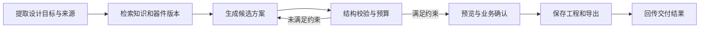

# 编排层与替代底座评估

调研日期：2026-11-10（Asia/Shanghai）。官方文档和仓库静态核查，未安装、运行或压测候选框架。

## 建议

优先保留 CowAgent 作为日常助手底座，把知识服务、工程任务和软件工具作为边界清晰的扩展。只有工程任务需要明确状态、分支和恢复时，才加入 LangGraph 工作流。替换底座的收益，应通过相同的真实任务验证，而不按功能名数量判断。

这个建议基于现有 CowAgent 仓库、用户希望逐步定制以及 RFLinkManager 的业务接口条件，是本次架构判断，不是对所有用户的框架排名。CowAgent 细节见同目录《CowAgent底座核查》。

## LangGraph 应承担什么

LangGraph 官方定位为有状态、长期任务的底层编排运行时，允许混合确定性步骤和模型步骤；它不限定提示词或代理架构。独立使用开源库不要求购买 LangSmith，也不要求采用 LangChain 的高层代理 API。[L1]

适合本项目的工作流示例：

图中的循环必须设置最大候选数、时间和模型费用预算；计算使用现有确定性引擎。不能把“反复让模型尝试”作为无限求解器。

| 能力 | 已核实事实 | 本项目需要另外实现 |
| --- | --- | --- |
| 会话与流程状态 | Checkpointer 保存单个线程的图状态，Store 保存跨线程数据。[L2] | 任务与消息映射、业务文件引用、资料版本，以及与 CowAgent 的职责划分。 |
| 等待输入 | `interrupt()` 可挂起并用相同线程恢复。[L3] | 飞书/微信回复关联到原任务、用户授权范围与超时策略。 |
| 失败处理 | 官方提供重试、超时和错误处理；部分节点级 API 要求 `langgraph>=1.2`。[L4] | 进程托管、重启后调度、外部软件可达性、取消传播。 |
| 数据持久化 | 内存 checkpointer 不跨进程重启；官方另有 SQLite/PostgreSQL 实现。[L2] | 选择数据库、备份/恢复与保存策略，不将示例内存存储用于“断电续跑”。 |
| 外部副作用 | 官方明确：恢复/重试可重复执行节点，外部写入需幂等或去重。[L3][L4] | 飞书发文、创建工程、导出上传的操作标识、结果回查与补偿。 |

建议以独立任务服务暴露 `submit / status / cancel / resume / artifacts`，由 CowAgent 调用；LangGraph 管理工程流程状态，CowAgent 管理对话。不要在两个系统中各建一套同等权威的对话历史、用户偏好和任务进度。

本机单用户、少量并行任务可从持久化 SQLite 原型起步；若实际出现多个工作进程竞争、并发写瓶颈或远程部署，再评估 PostgreSQL。这是部署建议，不是对生产规模的性能保证。

## 几个可以替代 CowAgent 的底座

| 候选 | 核实到的特点 | 与本需求的关系 | 当前建议 |
| --- | --- | --- | --- |
| CowAgent | 本地已检出的 Python 项目；现有通道、记忆、知识、工具和 MCP 的证据另见专项文档。 | 已有投入和本地代码，是定制的最低迁移成本起点。 | 优先验证。 |
| OpenClaw | 官方目前有原生 Windows Hub；默认本地引导可配置 WSL Gateway，另支持原生 Gateway/远端连接；Windows 节点能力和本地 MCP 可独立配置。[A1] | 适合重视多设备网关和节点体系的路线；不能据“有Windows节点”推断现成覆盖RFLink业务或全部桌面点击。 | 作为较完整的替代对照。 |
| nanobot | Python 自托管助手，现有通道、MCP、记忆、调度和 WebUI；支持 Windows 安装；官方 Python SDK 可嵌入同一运行时。[A2][A3] | 适合希望嵌入代码、缩小核心并自己维护的路线。SDK 的 session key 并不隔离工作区或凭据。[A3] | 想深度掌控核心时评估。 |
| QwenPaw（原 CoPaw） | 旧 `agentscope-ai/CoPaw` 地址现重定向至 QwenPaw；官方 README 声明使用 ReMe 记忆、Skills/Plugins、MCP、多通道和 Windows 安装。[A4] | 同样是完整助手产品，和 CowAgent 的职责重叠；切换不会自动补齐 RFLink、Office 或工程建模接口。 | 如偏好其生态，可运行同场景对照。 |
| 直接以 LangGraph 自建 | 提供流程运行时，不附带完整的消息产品和所有软件适配。[L1] | 会增加通道、配置、用户身份、文件交付、会话UI和运维开发。 | 暂不作为第一阶段主路线。 |

表中“适合”“建议”为本次推断；未进行稳定性、延迟、成本和任务成功率横测。三套完整助手不建议同时叠加运行。它们可以共享独立知识/工具服务，但主对话入口应有一个清晰的管理者。

## 版本与许可证核查快照

下列为读取时的 `main` HEAD；README 和文档是滚动内容，不能把主分支版本视为本机已安装版本。采用时应固定发行版/提交和锁文件。

| 项目 | 核查快照 | 许可证证据 |
| --- | --- | --- |
| LangGraph | `e5e37b5d70dbfd93c7006bd90a658c6179a95946`；源码包 `libs/langgraph/pyproject.toml` 声明 1.2.20、Python ≥3.10。 | MIT，见 [L5]。 |
| OpenClaw | `e95289326a7907f6ce926afbb4e81a03bbedef98`。Windows Hub 有独立发布节奏，不能和 Gateway 版本混用。[A1] | 核心仓库为 MIT，见 [A6]；部署前另核对节点及附加组件。 |
| nanobot | `62c05e7f7e6573900af439047fe1579a03deea26`；README 声明 Python ≥3.11；读取 releases API 得到最新发行 `v0.4.1`（2026-11-06），旧搜索摘要仍可能显示 0.3.5。[A7] | README 标示 MIT。[A2] |
| QwenPaw | `14b02c597aee1b314f9bd12f8813e01543c3c328`；README 声明 Python ≥3.11、<3.14；读取 releases API 得到 `v2.2.2.post1`（2026-10-22）。[A8] | README 标示 Apache-2.0。[A4] |

GitHub `releases/latest` 在多包仓库中可能指向 SDK 的版本；本次实际观察 LangGraph 该接口返回 `sdk==0.4.14`，因此不将它当作 `langgraph` Python 核心包的最新版。[L6]

## 本机部署含义

只读系统查询得到：Windows 11 家庭中文版、Core Ultra 5 125H、约 23.5 GiB 内存，可见 Intel Arc 集成显卡及虚拟显示适配器；未发现足以确认 CUDA 独立显卡的证据。Office 三个程序的 App Paths 已注册，未验证实际启动、授权或自动化能力；Blender 未在该入口注册，不据此认定未安装。

据此建议第一阶段采用本地助手与工具、本地可导出知识、按需调用云端模型。嵌入模型和OCR是否本地运行，用真实文档测速度与内存后决定。先不要同时常驻多个完整助手、全套重型 RAG 服务和大参数本地推理。

是否允许资料进入云端模型、模型服务商及月度预算仍待用户选择。本机数据落盘不等于模型调用不出网；调用路径应明确到解析、嵌入、重排、回答几个环节。

## 一手来源

- [L1：LangGraph 定位与独立使用](https://docs.langchain.com/oss/python/langgraph/overview)
- [L2：Persistence、Checkpointer 与 Store](https://docs.langchain.com/oss/python/langgraph/persistence)
- [L3：Interrupts 与副作用幂等要求](https://docs.langchain.com/oss/python/langgraph/interrupts)
- [L4：Fault tolerance](https://docs.langchain.com/oss/python/langgraph/fault-tolerance)
- [L5：核心包版本、依赖与许可证](https://github.com/langchain-ai/langgraph/blob/e5e37b5d70dbfd93c7006bd90a658c6179a95946/libs/langgraph/pyproject.toml)
- [L6：多包仓库 latest release 接口](https://api.github.com/repos/langchain-ai/langgraph/releases/latest)
- [A1：OpenClaw Windows 官方文档](https://docs.openclaw.ai/platforms/windows)
- [A2：nanobot 官方 README](https://github.com/HKUDS/nanobot/blob/62c05e7f7e6573900af439047fe1579a03deea26/README.md)
- [A3：nanobot Python SDK](https://github.com/HKUDS/nanobot/blob/62c05e7f7e6573900af439047fe1579a03deea26/docs/python-sdk.md)
- [A4：QwenPaw 官方 README](https://github.com/agentscope-ai/QwenPaw/blob/14b02c597aee1b314f9bd12f8813e01543c3c328/README.md)
- [A5：OpenClaw 官方仓库](https://github.com/openclaw/openclaw)
- [A6：OpenClaw 核心许可证](https://github.com/openclaw/openclaw/blob/e95289326a7907f6ce926afbb4e81a03bbedef98/LICENSE)
- [A7：nanobot 发行版](https://github.com/HKUDS/nanobot/releases/tag/v0.4.1)
- [A8：QwenPaw 发行版](https://github.com/agentscope-ai/QwenPaw/releases/tag/v2.2.2.post1)
- HEAD 查询入口：[LangGraph](https://api.github.com/repos/langchain-ai/langgraph/branches/main)、[OpenClaw](https://api.github.com/repos/openclaw/openclaw/branches/main)、[nanobot](https://api.github.com/repos/HKUDS/nanobot/branches/main)、[QwenPaw](https://api.github.com/repos/agentscope-ai/QwenPaw/branches/main)。
