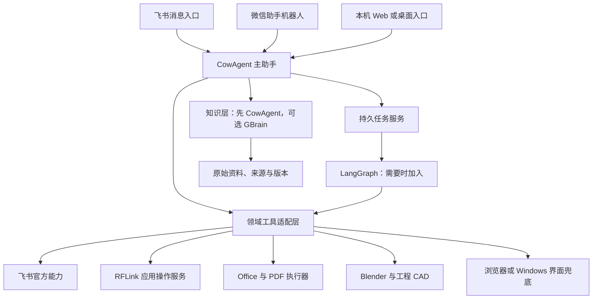

# Windows 超级个人助手方案评估（讨论稿）

调研日期：2026-11-10（Asia/Shanghai）。本轮目标是选型、边界核实和落地路线，未安装服务、授权账号或改造 RFLinkManager。

## 本轮判断

**当前明确推荐：首版不接入GBrain，也不引入LangGraph。** 采用 **CowAgent主助手 + 内置知识能力与资料解析 + 飞书业务工具 + Codex编程执行器 + RFLink业务接口**。首版不部署GBrain或迁移资料，也不将其对照评估放到关键路径。起步顺序和以后重新评估的条件见[起步技术路线建议](2026-11-10-起步技术路线建议.md)。

真正需要投入开发的部分是软件的业务操作接口、知识来源与更新规则，以及任务的结果验证。换一个通用助手框架通常不会自动补齐这些能力。这是结合本地源码和官方能力作出的架构判断。

已确认的用户偏好：

- 微信用于与专门的助手机器人沟通、下达任务；本轮不要求接管既有个人微信会话。
- GBRAIN 特指 [garrytan/gbrain](https://github.com/garrytan/gbrain)。
- 飞书要覆盖实际业务操作，不能只接收和回复消息。
- 首要专业软件是本机 RFLinkManager，任务包括链路设计；还需要 Office、PDF 和射频箱体/丝印建模。
- 方案按阶段讨论，尚未决定具体部署、模型供应商和月度费用预算。
- 后续澄清：知识库主要提供任务背景；用户希望统一助手入口，复杂编程目前使用Codex。专业执行器可由主助手协调，不以增加多个工具为目标，见[分工补充](2026-11-10-CowAgent与Codex的分工.md)。

## 已核查的本地条件

| 项目 | 已观察到的事实 | 证据与边界 |
| --- | --- | --- |
| CowAgent | 当前工作区就是上游 `zhayujie/CowAgent` 的检出；HEAD 为 `e5fe38af78c3d9fea7652615c6efdf4f32ba8e0f`。 | Git 只读查询和专项源码核查；没有安装或启动它。 |
| RFLinkManager | Electron + Workbench + Python 平台；已有平台 MCP、资源 HTTP API、工作区与预算领域模块；射频工具 MCP 目前只有 `ping`。 | 固定源码 `350298bda5b57d0f6b2c8766776e92095ce94f7c`，见[专项核查](2026-11-10-RFLinkManager助手接口评估.md)。 |
| 本机资源 | Windows 11，约 24 GB 内存，Core Ultra 5 125H，可见 Intel Arc 集显。 | 只读系统查询；未做模型性能测试，不能据此给出模型吞吐或并发承诺。 |
| Office | Word、Excel、PowerPoint 的 App Paths 已注册。 | 不等于已经验证应用可启动、授权或 COM 自动化可用。 |
| Blender | 未在本次检查的 App Paths 中注册。 | 不足以判断是否安装；部署前另查。 |

据此建议先采用云端模型推理、本地资料和执行器，按实际数据决定嵌入/OCR是否放在本机。知识检索、Office和RFLink可以先做低并发任务，不预设大模型和重型知识栈都要本机常驻。

## 各组件的职责

图中的“任务服务”“RFLink应用操作服务”和统一适配层是建议新增的项目能力。MCP 可作为工具访问协议；它定义上下文和工具交换，不替代业务实现或任务编排。[MCP 官方架构](https://modelcontextprotocol.io/docs/learn/architecture)

| 层 | 建议承担的内容 | 避免的重复 |
| --- | --- | --- |
| CowAgent | 消息路由、对话、模型调用、技能发现、日常工具调用。 | 不再启动另一套同等权威的主助手。 |
| 知识层 | 首版复用 CowAgent；需要跨代理事实治理时，再由 GBrain 管理该知识域。 | 两套系统不同时改写同一份长期事实。 |
| 原始资料 | PDF、Office、网页快照、厂商参数、工程文件和附件。 | 原始证据不被模型摘要覆盖。 |
| 任务服务 | 接收、状态查询、取消、重启对账和产物索引。 | 不把一条聊天历史当成完整的任务数据库。 |
| LangGraph | 有分支、重试、等待输入、候选比较的专业流程。 | 不同时接管所有闲聊和普通工具调用。 |
| 领域工具 | 参数校验、真实软件操作、确定性计算和结果回读。 | 不让模型复制 RFLink 引擎规则或直接改工程内部文件。 |

GBrain 的官方 README 描述了带来源的显式事实、纠正与撤回、跨代理访问和按需增加语义检索；这些是知识层候选的依据，实际部署/检索质量仍需验证。[GBrain README](https://github.com/garrytan/gbrain)

它可以从内嵌 PGLite 路径开始，不必一开始部署外置 PostgreSQL；但源码依赖 Bun，Windows 路径已有适配，服务托管与全流程仍待本机验证。它是需要单独维护的知识服务，而非一份提示词技能。[引擎架构](https://github.com/garrytan/gbrain/blob/a0af9b6689cd78520dda7132d34a93c95333f2f5/docs/ENGINES.md)、[包依赖](https://github.com/garrytan/gbrain/blob/a0af9b6689cd78520dda7132d34a93c95333f2f5/package.json)、[知识专项](2026-11-10-知识库与GBRAIN评估.md)

## 目标一：知识库应同时具备管理和沉淀

建议保存三类相互关联的数据：原始证据、可追溯的整理知识、对助手有用的个人偏好。临时任务状态单独保存。这样查器件参数时能回到原始规格书；回忆个人习惯时不必搜索所有技术PDF。

知识管理的最小闭环建议为：

1. **采集**：本机文件/文件夹、飞书指定空间、聊天中主动提交的附件或链接。先采用明确目录与范围。
2. **解析**：保留原文件；抽取正文、表格、图片说明；扫描PDF经过OCR并记录解析方式。
3. **记录来源**：文档标题、原路径/URL、内容哈希、版本/修订、页码/章节/表格位置、采集时间和适用项目。
4. **整理**：形成主题笔记、器件知识、设计经验与项目决策；模型推断与用户已确认事实区分保存。
5. **检索与回答**：文字检索、语义检索和必要的结构过滤；答案引用精确来源，遇到冲突显示版本与差异。
6. **纠正与更新**：用户纠正后，旧结论标记替代；原文更新触发重新解析；撤回资料需要同步处理派生笔记与索引。
7. **验证与备份**：以真实资料测检索与引用，并验证数据库和原附件恢复。索引应可重建，备份范围不能只看Markdown导出。

以上是需求契约建议，不宣称 GBrain 或 CowAgent 已经完整实现全链路。GBrain、现有知识 wiki 和专业 RAG 工具的具体差异见[知识专项](2026-11-10-知识库与GBRAIN评估.md)。

本地已确认 CowAgent 知识管理器直接导入只接受 `.md`、`.txt`；已有中文检索与可选向量检索，但 PDF、Office 和扫描件需要另建解析入口。优先补齐资料解析、页码/表格位置和原附件管理，比先增加另一个向量库更贴近当前缺口。[导入实现](D:/CodeAndDesign/CowAgent/agent/knowledge/service.py:42)、[检索与版本证据](2026-11-10-知识库与GBRAIN评估.md)

RFLink 的器件官方版本、参数和工程文件仍由 RFLink 管理；知识库保存说明、资料和可引用的业务记录，避免成为另一套会分叉的器件数据库。设计任务需要读取当前锁定版本，而不是只相信知识库里某次提取的旧参数。[RFLink专项](2026-11-10-RFLinkManager助手接口评估.md)

第一轮评测可选20份典型资料：数字原生PDF、扫描PDF、含复杂表格的规格书、Excel和几份历史工程说明。准备20～30个带标准来源的问题，覆盖精确型号、单位/条件、跨文档关联、旧新版本冲突、没有答案、纠正与撤回。这些数字是建议的评测规模，不是已完成的结果。

## 目标二：消息通道和业务工具分别接入

飞书负责正式工作入口和长任务回报；微信负责随手提问、收集资料和发起任务。来自两个通道的本人账号应映射到同一助手用户，任务按项目或会话分开，避免把多人群聊的所有成员都视为拥有本机执行权限。

一条消息进入后先生成可查询的任务记录，迅速回执；文件解析、预算、建模和报告导出异步运行。用户能追问进度、补充条件、取消，最终拿到产物和关键依据。跨通道查看同一任务也需要统一任务引用。

“随时沟通”取决于机器开机、网络和消息服务在线。API和文件任务可以设计为后台执行；需要交互桌面的操作另有登录/锁屏条件。若以后要求电脑休眠时仍能收任务，可以增加远端轻量消息收件箱；本机恢复后领取任务，或把允许的纯知识问答放到远端。这是后续部署选项，并非首版必须加云服务器。

**飞书优先采用“长连接消息入口 + 官方 CLI 执行 + OpenAPI/SDK补充”。** 用户给出的官方总览实际区分凭据、交互、执行三层；个人托管 MCP Token 链路将逐步下线，当前远程 MCP 主要覆盖云文档。因此不把远程 MCP 当作完整飞书执行底座。用户身份/应用身份及资源授权逐项验证。[官方能力总览](https://open.feishu.cn/document/mcp_open_tools/overview-of-lark-agent-integration-capabilities)、[MCP生命周期与CLI推荐](https://open.feishu.cn/document/mcp_open_tools/end-user-call-remote-mcp-server.md)、[通道专项](2026-11-10-飞书与微信接入边界.md)

**微信可优先试验腾讯官方个人微信 Bot 路径。** 官方插件已有扫码、长轮询、单聊消息能力，CowAgent 也已有独立的 `weixin` 通道。精确的 `context_token` 有效期与长期主动推送额度未从已读官方材料中确认；长任务回报首选飞书，微信发送失败后保留结果并允许查询，实际送达需回执验证。[腾讯官方插件](https://github.com/Tencent/openclaw-weixin)、[官方协议](https://github.com/Tencent/openclaw-weixin/blob/0ad1ae91347a938f52f1e4e2abd6dcda51e05f9e/docs/protocol_zh_CN.md)、[CowAgent通道源码](D:/CodeAndDesign/CowAgent/channel/weixin/weixin_channel.py)

## 目标三：用软件业务能力完成任务

统一策略建议为：**已有业务接口/原生脚本 → 有结构的应用自动化 → 界面操作兜底**。每次操作都回读结果，按任务保留产物和适量截图。截图用于确认界面，结构化结果用于确认工程状态。

| 软件或能力 | 主要接入路线 | 应验收的业务结果 |
| --- | --- | --- |
| 飞书 | 官方 CLI、OpenAPI/SDK、用户授权；按需补充界面操作。 | 指定文档/表格/知识库/日程等可读取和修改，结果能回查且符合授权身份。 |
| RFLinkManager | 薄 MCP/工具适配器接应用操作服务，复用共享领域模块、平台API和Electron宿主。 | 候选链路可编辑，预算结果可复现，工程保存往返正确，BOM/报告来自同一快照。 |
| Word / Excel / PowerPoint | 文件库处理常规结构，需原生排版/重算时使用对应软件自动化。 | 文件在目标应用中打开正常，公式/分页/字体/图表符合要求，导出可检查。 |
| PDF | 文本/表格解析、页面与标注编辑、表单/合并/生成分别选工具；必要时OCR。 | 文字、图形和页面结构正确，关键页渲染检查通过。 |
| Blender | 参数与脚本驱动建模、材质、标注/丝印视觉预览、渲染。 | 尺寸与孔位能回读，模型可重建，图像和源文件一并交付。 |
| 工程CAD补充 | 根据加工交付需求再评估 FreeCAD/CadQuery 等。 | STEP、实体、工程图和公差满足实际制造要求。 |

Office/PDF/建模的已核实能力和边界见[执行层专项](2026-11-10-桌面Office与建模执行层.md)。本表描述接入目标，尚未完成本机实测。

RFLink 是本项目最值得优先打通的专业能力。本次核实它已有业务函数和确定性计算：最小工具面可以覆盖工程查询、资源检索、候选变更、应用/校验、预算、预览、保存和交付。接口需处理活动编辑会话和修订冲突，不能仅操作磁盘上的旧文件。[RFLink专项](2026-11-10-RFLinkManager助手接口评估.md)

## CowAgent、GBrain、LangGraph 的组合取舍

**保留 CowAgent 主框架**：当前已有代码和通道基础，先测真实闭环。需要调整的重点是外部知识调用和领域工具，不预先重写全部代理循环。详细实现依据见[CowAgent专项](2026-11-10-CowAgent底座核查.md)。

**有条件引入 GBrain**：当跨代理共享、事实来源、纠正和长期知识治理是核心价值时，值得接入；如果首版只需少量Markdown笔记和问答，可以先验证现有知识能力与真实样本，避免先迁移全部个人资料。最终选定一个长期事实的写入管理者。[GBrain README](https://github.com/garrytan/gbrain)

**按任务引入 LangGraph**：适合链路设计、多候选预算和多软件交付。它提供图状态持久化和等待输入机制，实际的任务进程托管、外部软件适配和重试去重仍由应用实现。[LangGraph定位](https://docs.langchain.com/oss/python/langgraph/overview)、[持久化](https://docs.langchain.com/oss/python/langgraph/persistence)、[重试与幂等](https://docs.langchain.com/oss/python/langgraph/fault-tolerance)

需要补任务服务的直接原因是：CowAgent 已有历史与调度配置持久化，但未见重启后自动接管未完成代理循环的完整链路；当前调度实现会跳过逾期超过十分钟的执行点，过期一次性任务也有清理规则。工程任务不能只依赖聊天存档和定时配置，必须先持久接收，再跟踪具体操作结果。[调度实现](https://github.com/zhayujie/CowAgent/blob/e5fe38af78c3d9fea7652615c6efdf4f32ba8e0f/agent/tools/scheduler/scheduler_service.py#L236)、[源码核查](2026-11-10-CowAgent底座核查.md)

替代底座已核查 OpenClaw、nanobot 和 QwenPaw（原CoPaw）。前两者分别可以作为更完整的网关/节点路线与可嵌入Python路线对照。当前证据没有显示为了本需求必须立即从 CowAgent 迁移；最终用同一套知识、飞书和RFLink任务比较。[编排与替代底座专项](2026-11-10-编排层与替代底座评估.md)

## 分阶段推进与退出条件（建议）

| 阶段 | 交付范围 | 进入下一阶段的条件 |
| --- | --- | --- |
| 0：固定样本和边界 | 典型资料、一份已知工程、飞书操作清单；确定允许出网的数据、模型和预算。 | 三类真实任务及预期输出明确，知道哪些账号权限可获得。 |
| 1：可沟通的可靠助手 | CowAgent本机独立环境、飞书入口、一个只读工具与简单文件交付；验证微信机器人。 | 重复事件不重复执行；进度/结果能回传；重启后任务状态可核对。 |
| 2：可追溯知识闭环 | GBrain/现有知识方案样本对照，完成导入、引用、纠正和恢复。 | 典型问题能回到正确版本和页码；删除/更新和备份恢复有结果。 |
| 3：RFLink设计闭环 | 工程副本、选器件、连接、预算、变化预览、保存和报告。 | 结果与已知引擎一致；重新打开可编辑；重试和并发编辑不会破坏工程。 |
| 4：稳定专业工作流 | 按需加LangGraph；增加分支、补充条件、失败恢复和跨软件交付。 | 中断恢复后不重复写入，任务能取消，最终产物有统一来源快照。 |
| 5：扩展软件与常驻方式 | 扩大飞书业务、Office/PDF、参数化箱体/丝印、按需远端收件箱。 | 各软件有明确的能力清单、真实输出验证和运行条件。 |

阶段可以按用户最关心的价值调序。建议第一个专业闭环是“通过飞书下达RFLink候选链路设计，返回预算、BOM与报告”；它能同时验证入口、知识、软件操作和文件交付，暴露的接口缺口也最具体。

## 后续讨论中需要决定的事项

1. 优先价值：先把个人资料整理和检索做扎实，还是先完成RFLink链路设计闭环。
2. 飞书账号条件：个人/团队环境、能否创建自建应用、管理员可批准的权限和允许操作的数据空间。
3. 资料范围：文件数量/体量、PDF扫描比例、Excel/工程附件比例、飞书资料与本地资料谁为真源。
4. 模型与数据：哪些内容允许送模型API，已有可用服务商，月度调用预算。
5. 工程交付：箱体需要展示模型、3D打印，还是机加工STEP/工程图；丝印需要预览还是生产文件。
6. 常驻要求：这台电脑是否长期开机；电脑休眠时是否必须接收任务或立即执行。

这些问题决定后续实施，不影响本轮选型研究完成。下一步先确定一项首要闭环，再把对应工具清单与验收样例写成可讨论的规格。

## 专项材料与证据

- [起步技术路线建议：首版明确不接GBrain与LangGraph](2026-11-10-起步技术路线建议.md)
- [CowAgent、知识库与Codex分工补充](2026-11-10-CowAgent与Codex的分工.md)
- [CowAgent底座核查](2026-11-10-CowAgent底座核查.md)
- [知识库与GBRAIN评估](2026-11-10-知识库与GBRAIN评估.md)
- [飞书与微信接入边界](2026-11-10-飞书与微信接入边界.md)
- [RFLinkManager助手接口评估](2026-11-10-RFLinkManager助手接口评估.md)
- [桌面Office与建模执行层](2026-11-10-桌面Office与建模执行层.md)
- [编排层与替代底座评估](2026-11-10-编排层与替代底座评估.md)

本报告将事实、推断与建议分开；官方能力声明和本地静态源码不等于实际运行验收。账号权限、软件自动化、知识质量和任务恢复需要在后续原型中验证。没有因本轮研究更改用户资料或业务工程。
